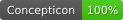
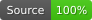
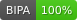
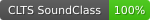

# CLDF dataset derived from Starostin's "Hmong Mien family in the Global Lexicostatistical Database" from 1991

## How to cite

If you use these data please cite
- the original source
  > Starostin, George S. (2011): Annotated Swadesh wordlists for the Hmong group (Hmong-Mien family). Moscow: The Global Lexicostatistical Database.
- the derived dataset using the DOI of the [particular released version](../../releases/) you were using

## Description

This dataset is licensed under a CC-BY-4.0 license

Conceptlists in Concepticon:
- [Starostin-1991-110](https://concepticon.clld.org/contributions/Starostin-1991-110)
## Notes

Tones were 'fake-phonetisized' and numbers only serve a purpose for distinguishing, not for true pronunciation values, as they were missing from the source material.

## Statistics

- **Varieties:** 20 (linked to 15 different Glottocodes)
- **Concepts:** 110 (linked to 110 different Concepticon concept sets)
- **Lexemes:** 1,827
- **Sources:** 1
- **Synonymy:** 1.01
- **Cognacy:** 1,827 cognates in 322 cognate sets (110 singletons)
- **Cognate Diversity:** 0.12
- **Invalid lexemes:** 0
- **Tokens:** 8,701
- **Segments:** 134 (0 BIPA errors, 0 CLTS sound class errors, 134 CLTS modified)
- **Inventory size (avg):** 43.90

# Contributors

Name | GitHub user | Description | Role
 --- | --- | --- | ---
Robert Forkel | @xrotwang | initial code | Other
Christoph Rzymski | @chrzyki | patron | Other
George Starostin | | data collection | Author, DataCollector

## CLDF Datasets

The following CLDF datasets are available in [cldf](cldf):

- CLDF [Wordlist](https://github.com/cldf/cldf/tree/master/modules/Wordlist) at [cldf/cldf-metadata.json](cldf/cldf-metadata.json)